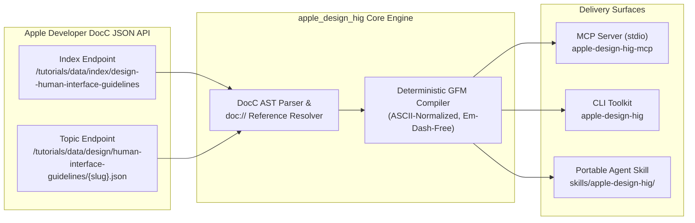

# apple-design-hig

[](https://github.com/mr8lu/apple-design-hig/actions/workflows/sync-hig.yml)
[](https://www.python.org/)
[](https://docs.astral.sh/uv/)
[](https://modelcontextprotocol.io/)
[](https://developer.apple.com/design/human-interface-guidelines/)

**Authoritative, deterministic access to Apple's Human Interface Guidelines for AI coding agents, design systems engineers, and Model Context Protocol (MCP) clients.**

[Overview](#overview) | [Architecture](#architecture) | [Quick Start](#quick-start) | [MCP Server](#model-context-protocol-mcp-server) | [CLI Reference](#command-line-interface-cli) | [Agent Skill](#bundled-agent-skill) | [Platform Matrix](#design-standards--platform-matrix) | [CI Sync](#automated-upstream-synchronization) | [Development](#development--verification)

---

## Overview

Interfaces demand precision. Yet most AI coding assistants rely on stale training weights when generating or auditing Apple-platform views - guessing touch-target dimensions, hallucinating deprecated navigation bars, or ignoring `visionOS` eye-gaze ergonomics and Liquid Glass material semantics.

`apple-design-hig` replaces guesswork with primary-source telemetry. It queries Apple's live, unauthenticated DocC JSON endpoints directly, traverses the canonical abstract syntax tree (AST) for over **172 official Human Interface Guidelines topics**, and compiles them into clean, deterministic GitHub-Flavored Markdown.

Engineered for zero-friction adoption across local terminals and sandboxed agent runtimes, this repository unifies three synchronized delivery surfaces:

1. **Bundled Agent Skill ([`skills/apple-design-hig/`](skills/apple-design-hig/))**: A portable, self-contained skill package featuring Apple's six core design principles, Section 508 / WCAG AA-AAA contrast mandates, pre-rendered Markdown references across all six HIG pillars, and a zero-dependency standard-library fetcher ([`scripts/hig_fetch.py`](skills/apple-design-hig/scripts/hig_fetch.py)).
2. **Model Context Protocol Server (`apple-design-hig-mcp`)**: A `FastMCP` server communicating over `stdio` that exposes four structured tools (`hig_list_sections`, `hig_search`, `hig_get_topic`, `hig_sync`) to Gemini CLI, Claude Desktop, Cursor, Windsurf, Zed, and any MCP-compliant host.
3. **Command-Line Interface (`apple-design-hig`)**: A fast terminal toolkit managed via `uv` to search the live HIG catalog, stream full topic specifications as Markdown, synchronize offline reference files, and provision local agent skill directories.

---

## Architecture

Every query and synchronization pass flows from Apple's production DocC JSON endpoints through a deterministic AST resolver and ASCII-normalized Markdown compiler.



### Upstream Data Endpoints

| Endpoint Role | Canonical URL |
| :--- | :--- |
| **DocC Index Tree** | `https://developer.apple.com/tutorials/data/index/design--human-interface-guidelines` |
| **Topic Document AST** | `https://developer.apple.com/tutorials/data/design/human-interface-guidelines/<slug>.json` |
| **Human-Readable Web Base** | `https://developer.apple.com/design/human-interface-guidelines/<slug>` |

The compiler recursively walks `primaryContentSections`, `topicSections`, and inline `references` dictionaries. It transforms DocC headings, nested ordered and unordered lists, multi-column tables, syntax-highlighted code listings, callout asides (`Note`, `Important`, `Tip`), and `doc://com.apple.HIG/...` cross-references into readable Markdown while enforcing strict typographic hygiene (converting `U+2014` and `U+2013` dashes into plain ASCII hyphens `-`).

---

## Quick Start

### Prerequisites

- **Python**: `>=3.12`
- **Package Manager**: [`uv`](https://docs.astral.sh/uv/)

### Option A: Zero-Install Execution (`uvx`)

Run any CLI command or launch the MCP server directly from GitHub without cloning the repository:

```bash
# Fetch and render an official Apple HIG topic as Markdown
uvx --from git+https://github.com/mr8lu/apple-design-hig apple-design-hig topic color

# Search across all 172+ topics
uvx --from git+https://github.com/mr8lu/apple-design-hig apple-design-hig search "liquid glass"

# Provision the skill into ~/.gemini/skills/ and ~/.agents/skills/
uvx --from git+https://github.com/mr8lu/apple-design-hig apple-design-hig install-skill
```

### Option B: Local Repository Setup (`uv`)

Clone the repository and synchronize the local virtual environment:

```bash
git clone https://github.com/mr8lu/apple-design-hig.git
cd apple-design-hig
uv sync
```

Run the 60-second verification tour:

```bash
# 1. Search the live Apple HIG catalog by keyword
uv run apple-design-hig search "navigation"

# 2. Scope searches to a specific HIG section
uv run apple-design-hig search "tab" --section "Navigation and search"

# 3. Stream any live HIG article into clean Markdown
uv run apple-design-hig topic typography
uv run apple-design-hig topic designing-for-visionos

# 4. Synchronize the local offline reference catalog with Apple's live DocC API
uv run apple-design-hig sync

# 5. Install the bundled skill into ~/.gemini/skills/ and ~/.agents/skills/
uv run apple-design-hig install-skill
```

---

## Model Context Protocol (MCP) Server

The `apple-design-hig-mcp` entrypoint (also invokable via `apple-design-hig mcp`) starts a standard-input/output (`stdio`) FastMCP server.

### Client Configuration

#### Zero-Install Configuration via `uvx` (Recommended)

Add the following block to `~/.gemini/settings.json` (Gemini CLI), `claude_desktop_config.json` (Claude Desktop), or `.cursor/mcp.json` (Cursor):

```json
{
  "mcpServers": {
    "apple-design-hig": {
      "command": "uvx",
      "args": [
        "--from",
        "git+https://github.com/mr8lu/apple-design-hig",
        "apple-design-hig-mcp"
      ]
    }
  }
}
```

#### Local Clone Configuration via `uv`

If you have cloned the repository locally, point `uv` to your checkout directory:

```json
{
  "mcpServers": {
    "apple-design-hig": {
      "command": "uv",
      "args": [
        "--directory",
        "/absolute/path/to/apple-design-hig",
        "run",
        "apple-design-hig-mcp"
      ]
    }
  }
}
```

### Exposed MCP Tools

| Tool Name | Signature | Return Type | Specification |
| :--- | :--- | :--- | :--- |
| `hig_list_sections` | `hig_list_sections()` | `dict[str, object]` | Retrieves the complete DocC index tree. Returns `total_topics` (`int`) and a `sections` mapping from each section title to its list of `{title, slug, url}` descriptors. |
| `hig_search` | `hig_search(query: str, section: str \| None = None)` | `dict[str, object]` | Executes case-insensitive substring matching across topic titles, slugs, and section names. Optional `section` narrows results. Capped at 50 matches per call. |
| `hig_get_topic` | `hig_get_topic(slug: str)` | `str` | Accepts a topic slug (`"buttons"`), relative path (`"/design/human-interface-guidelines/buttons"`), or full `developer.apple.com` URL and returns the live article compiled to Markdown. |
| `hig_sync` | `hig_sync()` | `dict[str, object]` | Synchronizes `skills/apple-design-hig/references/` (`catalog.md` plus all six pillar files) with Apple's live DocC endpoints and returns a sync summary. |

---

## Command-Line Interface (CLI)

Invoke the CLI via `uv run apple-design-hig <subcommand>` (or `apple-design-hig <subcommand>` when installed globally):

| Subcommand | Arguments & Flags | Behavior |
| :--- | :--- | :--- |
| `topic` | `<slug>` | Fetches and prints the complete Markdown article for any topic slug, relative path, or full URL (for example: `color`, `materials`, `buttons`, `designing-for-ios`). Returns exit code `1` on HTTP errors. |
| `search` | `<query> [--section <section>]` | Searches all 172+ Apple HIG topics by keyword and optional section filter, printing up to 50 formatted Markdown items with canonical URLs. |
| `sync` | `[--output-dir <path>]` | Fetches Apple's live DocC index and writes `catalog.md` plus the six core pillar Markdown files into `--output-dir` (defaults to `skills/apple-design-hig/references`). |
| `install-skill` | `[--skill-dir <path>]` | Installs `skills/apple-design-hig` into `~/.gemini/skills/apple-design-hig` and `~/.agents/skills/apple-design-hig`, cleanly replacing prior directories or symlinks. |
| `mcp` | *(none)* | Launches the `apple-design-hig` FastMCP server over `stdio`. |

---

## Bundled Agent Skill

Located in [`skills/apple-design-hig/`](skills/apple-design-hig/), the agent skill is architected for maximum portability - operating seamlessly inside restricted container sandboxes without third-party dependencies.

### Installing the Skill

```bash
# Via the built-in CLI installer (installs to ~/.gemini/skills and ~/.agents/skills)
uv run apple-design-hig install-skill

# Or via the Skills CLI
npx skills add mr8lu/apple-design-hig
```

### Skill Package Structure

- **[`SKILL.md`](skills/apple-design-hig/SKILL.md)**: High-density operational guide distilling Apple's six core design principles, a universal foundations checklist, Section 508 / WCAG AA-AAA contrast rules, and platform-specific heuristics.
- **[`references/catalog.md`](skills/apple-design-hig/references/catalog.md)**: Pre-built index of all 172+ official Apple HIG topics organized across Apple's six top-level pillars:
  - [`getting-started.md`](skills/apple-design-hig/references/getting-started.md) (`getting-started`) - Platform design entrypoints for iOS, iPadOS, macOS, watchOS, tvOS, and visionOS.
  - [`foundations.md`](skills/apple-design-hig/references/foundations.md) (`foundations`) - Accessibility, color, dark mode, layout, icons, immersive experiences, materials, motion, spatial layout, typography, and writing.
  - [`patterns.md`](skills/apple-design-hig/references/patterns.md) (`patterns`) - Drag and drop, entering data, feedback, file management, launching, loading, modality, navigation, onboarding, notifications, search, settings, and workouts.
  - [`components.md`](skills/apple-design-hig/references/components.md) (`components`) - Content views, layout and organization, menus and actions, navigation and search, presentation, selection and input, status, and system experiences.
  - [`inputs.md`](skills/apple-design-hig/references/inputs.md) (`inputs`) - Action button, Apple Pencil, Camera Control, Digital Crown, eyes, focus and selection, game controls, gestures, gyro and accelerometer, keyboards, pointing devices, remotes, and Siri.
  - [`technologies.md`](skills/apple-design-hig/references/technologies.md) (`technologies`) - AirPlay, App Clips, Apple Pay, CarPlay, Game Center, HealthKit, HomeKit, iCloud, Live Activities, Mac Catalyst, Passkeys, SharePlay, Siri, Tap to Present, VoiceOver, and Widgets.
- **[`scripts/hig_fetch.py`](skills/apple-design-hig/scripts/hig_fetch.py)**: Standalone CLI built strictly on the Python standard library (`urllib.request`, `json`, `argparse`, `pathlib`). Agents can invoke it directly in any Python 3 environment without `uv` or `mcp`:

```bash
python3 skills/apple-design-hig/scripts/hig_fetch.py topic color
python3 skills/apple-design-hig/scripts/hig_fetch.py search "tab bar"
python3 skills/apple-design-hig/scripts/hig_fetch.py sync
```

---

## Design Standards & Platform Matrix

The `apple-design-hig` skill enforces concrete, measurable interface invariants derived from Apple's Foundations and Platform guides alongside Section 508 / WCAG AA-AAA accessibility thresholds:

| Platform | Canonical HIG Slug | Minimum Hit Target | Core Ergonomic & Visual Mandates |
| :--- | :--- | :--- | :--- |
| **iOS** | `designing-for-ios` | `44 x 44 pt` | Portrait-first thumb reachability, bottom tab bars for top-level navigation, pull-down menus, swipe actions, and crisp haptic feedback. |
| **iPadOS** | `designing-for-ipados` | `44 x 44 pt` | Adaptive multi-column split views, collapsible sidebars, pointer hover effects, full keyboard shortcut support, and drag-and-drop. |
| **macOS** | `designing-for-macos` | `28 x 28 pt` | Dense resizable multi-window workflows, comprehensive menu bar hierarchy, sidebars + toolbars, context menus, and full keyboard navigation. |
| **watchOS** | `designing-for-watchos` | `44 x 44 pt` | Glanceable single-screen interactions, Digital Crown scrolling, high-contrast dark backgrounds, **SF Compact** typography, and Smart Stack widgets. |
| **tvOS** | `designing-for-tvos` | Focus-driven | 10-foot viewing distance, directional focus engine with parallax and scale states, generous spatial padding, and large-scale typography. |
| **visionOS** | `designing-for-visionos` | `60 x 60 pt` (`12 pt` gap) | Translucent glass windows in shared space, indirect eye-gaze hover highlights paired with pinch gestures, comfortable field-of-view placement, and spatial audio. |

### Universal Foundation Invariants

- **Hierarchy & Clarity**: Controls defer to content. Use negative space, grouping, and typographic scale so primary actions are unmistakable at a glance.
- **Contrast & Accessibility**: Enforce at least a `4.5:1` contrast ratio for normal text and `3:1` for large text, targeting `7:1` (WCAG AAA) wherever possible. Never rely on color alone to communicate status or interactivity; pair color with SF Symbols, explicit text labels, or distinct geometry. Support Dynamic Type, VoiceOver labels, Reduced Motion (`prefers-reduced-motion`), Increase Contrast, and Full Keyboard Access.
- **Semantic Color & Dark Mode**: Use semantic system colors (`label`, `secondaryLabel`, `systemBackground`, `secondarySystemBackground`, `tintColor`) that adapt automatically across Light, Dark, and Increased Contrast appearances. Convey depth in Dark Mode through elevated surface luminance steps rather than drop shadows.
- **Typography**: Pair **SF Pro** (sans-serif), **SF Compact** (`watchOS`), **SF Mono** (code and tabular numerals), and **New York** (serif) with system Dynamic Type styles (`Large Title`, `Title 1-3`, `Headline`, `Body`, `Callout`, `Subhead`, `Footnote`, `Caption 1-2`) rather than fixed pixel sizes.
- **Materials & Liquid Glass**: Apply system materials (`ultraThinMaterial`, `thinMaterial`, `regularMaterial`, `thickMaterial`, Liquid Glass) to transient bars, sheets, sidebars, and overlays so background context subtly shines through without compromising foreground legibility.

---

## Automated Upstream Synchronization

A scheduled GitHub Actions workflow ([`.github/workflows/sync-hig.yml`](.github/workflows/sync-hig.yml)) keeps the repository's pre-rendered reference catalog aligned with Apple's live documentation:

- **Cadence**: Runs every Monday at `09:00 UTC` (`cron: "0 9 * * 1"`), on every push to `main`, and on manual `workflow_dispatch`.
- **Verification Gate**: Runs `uv run pytest` before executing any network sync.
- **Autonomous Commits**: Executes `uv run apple-design-hig sync` and automatically commits any upstream DocC additions or revisions inside `skills/apple-design-hig/references/` back to `main`.

---

## Repository Layout

```text
apple-design-hig/
├── .github/
│   └── workflows/
│       └── sync-hig.yml              # Weekly CI test suite & DocC reference auto-sync
├── skills/
│   └── apple-design-hig/
│       ├── SKILL.md                  # Portable agent skill instructions & checklists
│       ├── references/               # Pre-rendered offline catalog & 6 HIG pillars
│       │   ├── catalog.md
│       │   ├── components.md
│       │   ├── foundations.md
│       │   ├── getting-started.md
│       │   ├── inputs.md
│       │   ├── patterns.md
│       │   └── technologies.md
│       └── scripts/
│           └── hig_fetch.py          # Zero-dependency stdlib DocC CLI fetcher
├── src/
│   └── apple_design_hig/
│       ├── __init__.py               # Package metadata
│       ├── cli.py                    # CLI argument parser & subcommands
│       ├── client.py                 # DocC JSON client, AST renderer & skill installer
│       └── mcp_server.py             # FastMCP stdio server implementation
├── tests/
│   └── test_hig.py                   # Unit tests for slug normalization, AST rendering & install
├── GEMINI.md                         # Workspace conventions & agent instructions
├── pyproject.toml                    # Package manifest & uv_build configuration
└── README.md                         # Project documentation
```

---

## Development & Verification

Run the unit test suite via `uv`:

```bash
uv run pytest -v
```

### Engineering Conventions

- **Environment Management**: Always use `uv` for dependency resolution, testing, and execution (`uv sync`, `uv run pytest`, `uv run apple-design-hig ...`).
- **Standard-Library Portability**: Keep `skills/apple-design-hig/scripts/hig_fetch.py` strictly compatible with the Python standard library so the packaged skill operates in any environment without external dependencies.
- **Punctuation Hygiene**: Never use the em dash character (`U+2014`) in source code, docstrings, or generated Markdown; use plain ASCII hyphens (`-`) instead.
